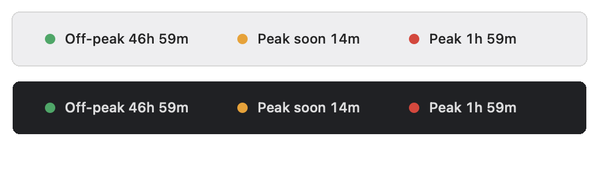
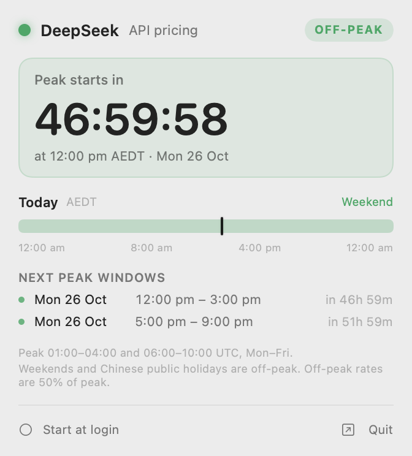
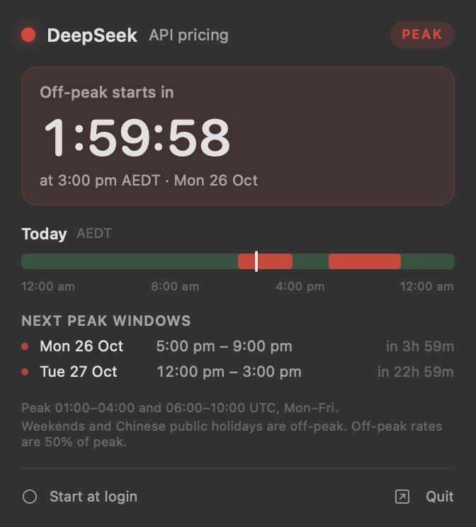
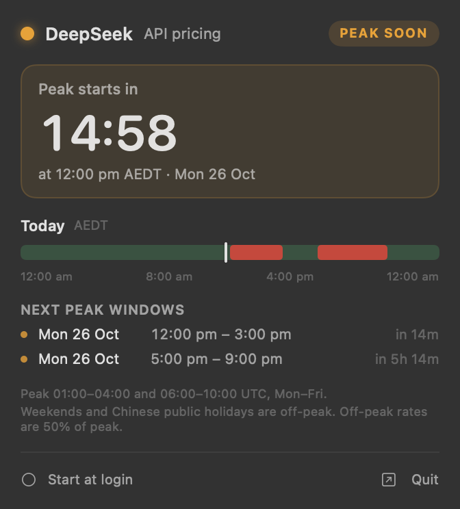

# DeepSeek Peak

[](https://github.com/johnhumphrys/deepseek-peak-menubar/actions/workflows/ci.yml)

A tiny macOS menu bar app that shows whether DeepSeek's API is currently in **peak** or **off-peak** pricing — and exactly how long until that changes.



- 🟢 **Green** — off-peak (half price)
- 🟡 **Yellow** — peak starts within the warning window (30 min by default)
- 🔴 **Red** — peak pricing is active

Click the item for a live countdown, today's peak timeline in your local time, and the next peak windows. Right-click for settings.



## Install

Requires macOS 13 or later (Apple silicon or Intel). There are no dependencies, no API keys, and no network calls.

```bash
git clone https://github.com/johnhumphrys/deepseek-peak-menubar.git
cd deepseek-peak-menubar
make install
```

`make install` builds a release binary, assembles `DeepSeek Peak.app`, copies it to `~/Applications` (no sudo needed), and launches it. Other targets:

| Command | What it does |
| --- | --- |
| `make run` | Build and launch from `dist/` without installing |
| `make test` | Run the unit test suite |
| `make dump` | Print the upcoming schedule in your local time |
| `make uninstall` | Quit and remove the installed app |
| `make icon` | Regenerate the app icon from `scripts/make-icon.py` |

The app is an accessory (no Dock icon) and lives only in the menu bar.

## The schedule

DeepSeek defines peak hours on the [API pricing page](https://api-docs.deepseek.com/quick_start/pricing):

> Peak hours are 01:00–04:00 and 06:00–10:00 UTC, Monday through Friday, excluding Chinese public holidays. All other hours are off-peak, including weekends and Chinese public holidays in full. Off-peak rates are half of the peak rates.

In Melbourne, for example, that works out to:

| | UTC | Melbourne (AEST/AEDT) |
| --- | --- | --- |
| Peak | 01:00–04:00 | 12:00–15:00 (AEDT) / 11:00–14:00 (AEST) |
| Off-peak | 04:00–06:00 | 15:00–17:00 / 14:00–16:00 |
| Peak | 06:00–10:00 | 17:00–21:00 / 16:00–20:00 |
| Off-peak | 10:00–01:00 | 21:00–12:00 / 20:00–11:00 |

All schedule arithmetic happens in UTC, so daylight-saving transitions cannot shift a window; the local time zone is used only for display. Fridays roll straight into weekend off-peak, and holiday weekdays (National Day, Spring Festival, …) count as off-peak all day.

## Using it

**Left click** opens the popover:

- a live countdown to the next change ("Peak starts in 2:14:03" / "Off-peak starts in 41:12")
- today's timeline in local time, with a marker for now
- the next two peak windows
- one-click "Start at login"



**Right click** opens the menu:

| Item | Options |
| --- | --- |
| Menu Bar Shows | Dot only · State · State + countdown (default) |
| Warn Before Peak | 10 / 15 / 30 (default) / 60 / 120 minutes |
| Launch at Login | Registers the app with `SMAppService` |
| DeepSeek Pricing… | Opens the official pricing page |
| Quit DeepSeek Peak | — |



## Chinese holidays

Weekends never carry peak windows, and neither do Chinese public holidays. The built-in list comes from the State Council's official 2026 notice ([国办发明电〔2025〕7号](https://www.gov.cn/zhengce/zhengceku/202511/content_7047091.htm)). Note that "make-up workdays" (调休) do **not** turn a Saturday back into a peak day — the pricing page says weekends are off-peak in full.

Chinese holiday dates are announced each November for the following year. To extend the calendar without rebuilding, add dates to:

```
~/.config/DeepSeekPeak/holidays.txt
```

```text
# YYYY-MM-DD Name
2027-01-01 New Year's Day
2027-02-06 Spring Festival
```

Lines may be commented with `#`; the name is optional. Overrides are merged over the built-in list and read when the app starts, so relaunch after editing. Set `DEEPSEEK_PEAK_CONFIG_DIR` to store the file somewhere else.

## Command line

The same binary can print the schedule, which is handy for verifying the rules or scripting:

```console
$ ./.build/release/DeepSeekPeakBar --dump --days 5 --tz Australia/Melbourne
DeepSeek API peak schedule
Time zone: Australia/Melbourne (AEDT)
Now: Sat 24 Oct 2026, 1:45 pm — off-peak · peak starts in 46h 15m
       next change Mon 26 Oct, 12:00 pm AEDT
Lead time: 30m (yellow when a peak starts within this)
Rules: peak 01:00–04:00 & 06:00–10:00 UTC, Mon–Fri; weekends and Chinese public holidays are off-peak.

Next 5 days:
  Sat 24 Oct 2026   off-peak all day — Weekend  ← today
  Sun 25 Oct 2026   off-peak all day — Weekend
  Mon 26 Oct 2026   12:00 pm – 3:00 pm,  5:00 pm – 9:00 pm
  Tue 27 Oct 2026   12:00 pm – 3:00 pm,  5:00 pm – 9:00 pm
  Wed 28 Oct 2026   12:00 pm – 3:00 pm,  5:00 pm – 9:00 pm
```

Options: `--days N`, `--at <ISO-8601>`, `--tz <identifier>`, `--lead <minutes>`.

## How it works

```
Sources/PeakCore/          schedule engine (pure Swift, no AppKit)
  PeakSchedule.swift       peak windows, phase, snapshot, local-day timeline
  Holidays.swift           Chinese public holidays + parser for overrides
  DurationText.swift       countdown formatting
  LocalDateTime.swift      local-time display helpers
  Preferences.swift        UserDefaults-backed settings
Sources/DeepSeekPeakBar/   menu bar app
  StatusItemController.swift  NSStatusItem, popover, context menu, 1 s timer
  PopoverView.swift           SwiftUI popover
  AppModel.swift              clock + settings, republished to the views
  main.swift                  entry point, --dump / --help
Tests/PeakCoreTests/       51 unit tests
```

The engine walks the UTC calendar and emits the peak windows for the surrounding three weeks, then asks one question: is now inside a window, and how far away is the next boundary? Because the windows are generated in UTC, the same code produces the same answer in any time zone, and the "approaching" state is simply `nextStart - now <= leadTime`.

The menu bar label is rebuilt only when its text changes (once a minute), while the popover countdown ticks once a second.

CI (`.github/workflows/ci.yml`) runs the release build, the full test suite, and the `.app` assembly on every push to `main` and on pull requests.

## Development

```bash
swift test          # 51 tests: windows, boundaries, weekends, holidays, DST, formatting, parser
swift build         # debug binary at .build/debug/DeepSeekPeakBar
make app            # release .app at dist/DeepSeek Peak.app
```

QA hooks, useful for screenshots and for checking a future date without waiting:

| Hook | Effect |
| --- | --- |
| `DEEPSEEK_PEAK_FAKE_NOW=2026-10-26T00:45:00Z` | Pretend it is this instant |
| `DEEPSEEK_PEAK_APPEARANCE=light\|dark` | Force light/dark appearance |
| `DEEPSEEK_PEAK_SHOW_POPOVER=1` | Open the popover on launch |
| `--render <dir>` | Write PNGs of the real status item and popover views, then quit |
| `--print-menu` | Print the context menu tree, then quit |

```bash
DEEPSEEK_PEAK_FAKE_NOW=2026-10-26T02:00:00Z \
  "dist/DeepSeek Peak.app/Contents/MacOS/DeepSeekPeak" --render /tmp/preview
```

The images in `docs/` are produced this way: they are `cacheDisplay` renders of the app's own views, not mockups or screen captures.

## Notes

- DeepSeek can change its pricing rules at any time; the [pricing page](https://api-docs.deepseek.com/quick_start/pricing) is the source of truth. The rules above were checked in October 2026.
- "Peak" here means **API pricing**, not the web chat's load.
- No telemetry, no network access, no background agents — just a timer and some date arithmetic.
- Not affiliated with DeepSeek.

## License

MIT — see [LICENSE](LICENSE).
